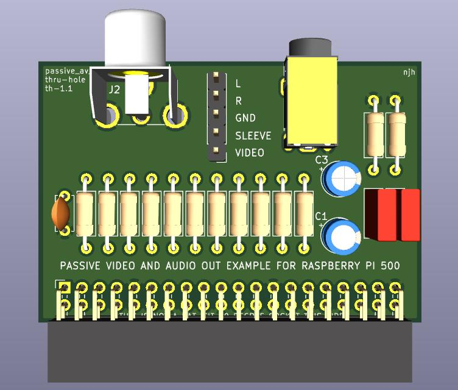

# Passive A/V example circuit for Raspberry Pi 500

**This is the through-hole version, for easy hand assembly.** See the main branch for the original SMD version.

This simple circuit demonstrates composite video and audio out from Raspberry Pi 5 series computers, using only passive components (it cannot produce composite video from Raspberry Pi 400 or earlier models).  Audio quality is limited: some power supply noise may be audible. The circuit is nevertheless useful for less-demanding applications.

This is not an official product. It has not undergone regulatory testing. But you can make and adapt it.



The [board](kicad) was designed using KiCad 9.0. [Production files](production) were generated using the JLCPCB plugin. They are provided without any warranty of correctness or manufacturability.

## Quick instructions

 * Ensure you can log in remotely, in case you end up with no display.
 * Edit `config.txt` to add:
   * `dtoverlay=vc4-kms-v3d,composite` (append `,composite` to the existing `vc4-kms-v3d` line, if present).
   * `dtoverlay=vec-gpio-pi5,gpio27`
   * `dtoverlay=audremap,pins_12_13`
   * `power_force_3v3_pwm=1`
 * Optionally, set a video mode in `cmdline.txt` (the default will be 704x432i NTSC).
 * Power off before connecting anything.
 * Connect to Raspberry Pi 500 or 500+, ensuring connector is centrally aligned and covers all header pins! Component side up.
 * or install vertically on a Raspberry Pi 5 or CM5IO header, with component side facing towards the Raspberry Pi's HDMI ports.
 * To get both audio and video through the jack socket, connect a jumper between VIDEO and SLEEVE pins.
 * Unplug HDMI before booting with composite video enabled.

No picture? You might not have the new overlay. Type this (after Ctrl-Alt-T if using the GUI):

```
   pinctrl 4-11,27 a1
```

## Circuit notes

Here are the [schematic](images/schematic.pdf) and [list of components](production/bom.csv).

### Video

On the RP1 chip, three copies of an 8-bit signal from the VEC (video encoder) can be brought out to GPIO pins 4-27, with an optional clock on GPIO 0 (rather like DPI). It is usually clocked at 108 MHz.

Here we use a simple 7-bit resistor DAC. To improve linearity, the MSB is driven by two separate GPIOs (11 and 27).

Resistor values were chosen to approximate the sequence (490 x 2<sup><i>n</i></sup>) - 20 &Omega;. At least R1-R3, and preferably all resistors, should have 1% tolerance. More precise values for R5 and R7 might be 1.96 k&Omega;, 7.87 k&Omega;.

The output is DC-coupled with an impedance of about 125 &Omega;. Peak output is about 1.2 V into a 75 &Omega; load.

### Audio

This is a variant of the PWM filter used in some Raspberry Pi models, omitting the regulator and buffer for simplicity. Although intended for use with a TV or amplifier, it can (quietly) drive headphones with impedance &ge; 32 &Omega;.

C1, C3 footprints suit radial electrolytic capacitors with 2mm lead spacing. 20% tolerance and 10 V rating are fine.

### Connectors

J2 is Same Sky RCJ-014, available from DigiKey. Other sockets exist with similar footprints.

J4 is Tensility 54-00174. There are other similar-shaped TRRS sockets (some bending of pins may be required).

J3 is a 5-pin header, for testing and to make the video->J4 connection optional (otherwise, headphones could short the video signal). You could hard-wire a link here to omit J2, J3 and use only J4.

J1 is a 2.54mm 2x20 right-angle (horizontal) socket (female). This unusual choice was made with Raspberry Pi 500 in mind. Do **not** fit a socket on the underside! You would have to change the layout to adapt the board to HAT form factor.

### A note on missing footprints

The repository does not include any footprint or symbol libraries. Footprints for J2 and J4 are available from SnapMagic Search, Inc.

Note that I **changed their pin numbers** to match KiCad's symbols, trimmed silkscreen at board edges, and modified KiCad's `Raspberry_Pi_2_3` symbol to separate the GND pins.

## Version history

**2.0** First published SMD version. Added tooling holes. Tested, works well.

**2.1** Add ground plane vias. Increase audio resistors, to reduce GPIO peak current (slightly reducing audio level). Move J2 slightly.

**thru-hole/th-1.0** (untested). Through-hole version with different footprints and some component tweaks. C1, C3 replaced by electrolytic capacitors. R10, R12 changed to 270 &Omega; for availability.

**thru-hole/th-1.1** (untested). Through-hole version. Remove unused layers (solder paste, adhesive). Change C1, C3 footprints to 2.0mm pin spacing.
